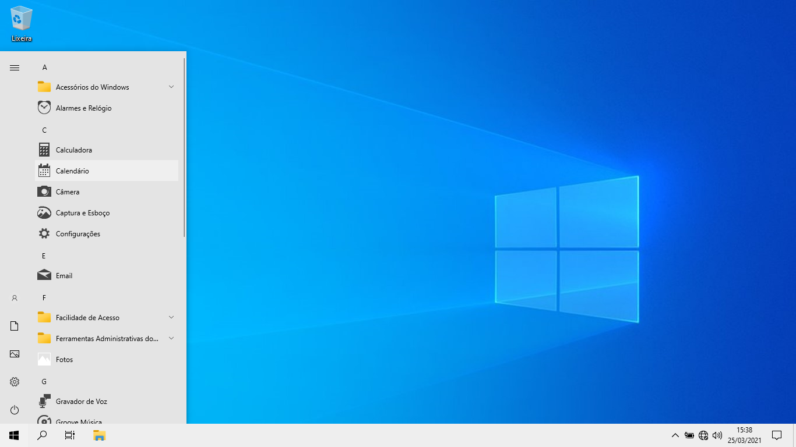

# Windows Booster

Interface gráfica para otimizar, limpar e equipar o **Windows 10 e 11** — em um único arquivo PowerShell com WPF (a mesma receita do WinUtil do Chris Titus).

## 📁 Estrutura do Projeto

| Arquivo | Descrição |
|---|---|
| `Windows-Booster.ps1` | GUI principal — 1.417 linhas, 8 abas, tema escuro, PowerShell 5.1 + WPF |
| `Iniciar-Windows-Booster.bat` | Launcher que eleva para administrador e abre a GUI |
| `removeApps.ps1` | Script original de remoção de apps UWP (do repositório antigo) |
| `silent.bat` | Script legado de configuração (`.reg` + remoção de apps + wallpaper) |
| `changeWallpaper.reg` | Registro para trocar papel de parede padrão |
| `cortana-voiceActivationDisableAboveLockscreen.reg` | Desativa voz acima da tela de bloqueio |
| `defender-disableAntiSpyware.reg` | Desativa Windows Defender (modo risco) |
| `disable*.reg` | Vários `.reg` de tweaks (telemetria, transparência, animações, etc.) |
| `StartLayout.xml` | Layout do Menu Iniciar travado (Windows 10) |
| `taskbar-removeCortanaAndPeopleBand.reg` | Remove banda de pessoas e Cortana da taskbar |
| `update-DisableDoSvc.reg` | Desativa serviços de atualização do Windows |
| `update-ActiveHours.reg` | Define horas ativas 07h-23h |
| `screen.png` | Captura de tela da interface antiga |
| `wall.png` | Papel de parede do projeto (aplicado pelo `/w`) |
| `README.md` | Esta página |
| `.git/` | Repositório Git inicializado |

## Windows Booster GUI (novo)

**Como abrir:** dê dois cliques em `Iniciar-Windows-Booster.bat` (pede permissão de administrador sozinho), ou botão direito em `Windows-Booster.ps1` → *Executar com PowerShell*.

| Aba | O que faz |
| --- | --- |
| **Início** | Estado do sistema (Windows, RAM, disco, winget) e guia rápido de como usar |
| **Bloatware** | Remove apps pré-instalados (lista do `removeApps.ps1` + inteligência Win11Debloat/Windows10Debloater), incluindo OneDrive, para todos os usuários e bloqueando reinstalação |
| **Limpeza** | Temporários, cache do Windows Update, lixeira, prefetch, miniaturas, DNS, dumps, caches de navegador, recursos opcionais (WordPad/IE/Quick Assist), `Windows.old` e DISM — mostra MB liberados |
| **Tweaks** | Porta **todos** os `.reg` deste projeto + telemetria, anúncios, Copilot/IA, CEIP, tarefas agendadas, Game DVR, menu Win11 clássico etc. Grupos A–D (seguros) e E (risco, desligado por padrão). Tudo com botão **Reverter** |
| **Desenvolvedor** | `winget` silencioso: Git, VS Code, Chrome, Python, 7-Zip, Node, Docker Desktop, VS 2022, .NET, Go, JetBrains Toolbox, SSMS + recursos do Windows (WSL2, Hyper-V, .NET 3.5) + campo para IDs extras do winget |
| **IObit** | IObit Uninstaller, Driver Booster e Advanced SystemCare via winget |
| **Drivers** | Dell Command Update, Dell SupportAssist, Lenovo System Update |

Topo da janela: **Otimização recomendada (1 clique)** — ponto de restauração + limpeza + remoção do bloatware padrão + tweaks seguros —, **Ponto de restauração** e **Reiniciar Explorer**. Tudo é logado no `Windows-Booster.log`.

> Baseado na inteligência dos projetos [Win11Debloat (Raphire)](https://github.com/Raphire/Win11Debloat), [WinUtil (ChrisTitusTech)](https://github.com/ChrisTitusTech/winutil) e [Windows10Debloater (Sycnex)](https://github.com/Sycnex/Windows10Debloater) — Licença MIT.

---

## Script legado de configuração para Windows 10 x64 20H2

O modo script original continua funcionando igual. Esse script adequa o Windows 10 para melhor desempenho em máquina de baixo poder de processamento.

### O que o script faz

- Ativação por voz desativada acima da tela de bloqueio
- Desabilita o feed de atividades
- Desativa lembretes na tela de bloqueio
- Desativa rotação de imagens da tela de bloqueio
- Desativa imagem de fundo da tela de bloqueio
- Desativa sugestão de conteúdo
- Desativa transparência
- Desativa animações e sombras do Windows Explorer
- Desabilita o Peek
- Desativa mostrar conteúdo da janela ao arrastar
- Desabilita arquivos recentes e frequentes do Windows Explorer
- Mostra extensão de arquivos no Windows Explorer
- Desativa aplicativos recentes no Menu Iniciar
- Deixa Menu Iniciar simples sem área de tiles
- Simplifica barra de tarefas
- Aplica horário ativo das 7h às 23h
- Modifica imagem de plano de fundo padrão (caso use `/w`)
- Desativa Windows Defender (caso use `/d`)
- Desabilita horário de verão (caso *não* use `/t`)
- Desativa Windows Update (caso use `/u`)
- Remove aplicativo de Clima
- Remove aplicativo Dicas
- Remove aplicativo Noticias
- Remove aplicativo OneNote
- Remove aplicativo Telefone
- Remove aplicativo Holographic
- Remove aplicativo Print3D
- Remove aplicativo 3DViewer
- Remove aplicativo Skype
- Remove aplicativo Spotify
- Remove aplicativo XBox
- Remove aplicativo CandyCrush
- Remove aplicativo MixedReality
- Remove aplicativo OneConnect
- Remove aplicativo Office
- Remove aplicativo Cortana
- Remove aplicativo Filmes e TV
- Remove aplicativo Onedrive

### Como usar

> Só use este script assim que instalar o Windows. Pois ele poderá remover apps que talvez você utilize como o office.

1. Baixe o repositório `win10-fast_x64`.
1. Abra o terminal do windows `cmd` como Administrador.
1. Navegue até o a pasta do projeto usando: `cd Caminho/Para/Pasta/Do/Projeto`.
1. Execute no comando:
    ```
    silent.bat /w /d /t /u

    Onde:
    /w  Troca o plano de fundo
    /d  Desativa o Windows Defender
    /t  Não desativa o horário de verão
    /u  Desativa o Windows Update
    ```
    
1. Espere o script terminar de executar até liberar novamente o terminal.
1. Reinicie a máquina.

### Captura de Tela



### Tutorial em Vídeo

[](http://www.youtube.com/watch?v=H_uzbKVE8g0)

---

## 🛠️ Git - Versionamento

Este repositório foi inicializado e publicado no GitHub com os comandos:

```bash
echo "# windows-booster" >> README.md
git init
git add README.md
git commit -m "first commit"
git branch -M main
git remote add origin git@github.com:tantoniazi/windows-booster.git
git push -u origin main
```

Os arquivos `Windows-Booster.ps1`, `Iniciar-Windows-Booster.bat` e o `README.md` atualizado já estão prontos para serem versionados. Commits futuros podem adicionar novas funcionalidades, correções ou melhorias na interface.